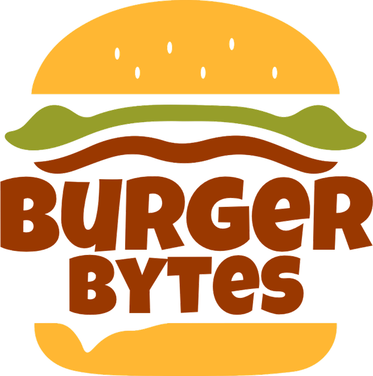

# 🍔 Burger Bytes: counter, kitchen & delivery system

There are three staff screens, linked live, and an owner dashboard. **Intake** takes the order and the money and gives a token. **Kitchen** makes it and taps READY. **Delivery** gets an alert and hands it over. **Admin** watches everything.

## 🔗 Screens
| Screen | Link | Who |
|---|---|---|
| 🏠 Home (pick a screen) | https://shavivsoft.github.io/FOOD-STALL/ | |
| 🧾 Intake / counter | https://shavivsoft.github.io/FOOD-STALL/intake.html | takes orders + money |
| 👨‍🍳 Kitchen | https://shavivsoft.github.io/FOOD-STALL/kitchen.html | makes burgers |
| 🛎️ Delivery | https://shavivsoft.github.io/FOOD-STALL/delivery.html | hands over food |
| 📊 Admin | https://shavivsoft.github.io/FOOD-STALL/admin.html | owner |
| 🗄️ Supabase | https://supabase.com/dashboard/project/vyfbyihamirthdftkfxg | database |

## How a token moves
1. **Intake** taps the items (🧀 With cheese / No cheese / 🥤 Diet Coke), turns 🛍️ **Parcel** on or off, and picks **Cash / UPI / Pay later**. Then **PLACE ORDER** shows a giant token number to tell the customer.
2. **Kitchen** gets a beep. Token cards show oldest first, with big item counts, a PARCEL tag and minutes waiting (orange after 7 min, red after 12). The cook taps **✅ READY**. *START* is optional.
3. **Delivery** gets a loud beep, a vibration and a full-screen **"READY — DELIVER NOW #12"**. They tap **✅ DELIVERED** once it's handed over. No prices are shown here: money is handled only at intake.
4. If intake **cancels** a token, the kitchen (or delivery) gets a red **"CANCELLED — DO NOT MAKE"** screen.
5. Every screen has **undo** for mis-taps. Admin can change any token from the **Change** menu.

## Admin dashboard
- **Staff screens:** whether each screen is online, plus orders taken, cooking now, tokens made, average kitchen time, waiting for delivery, delivered and average delivery wait.
- **Money:** paid revenue, 💵 cash vs 📱 UPI, unpaid tokens, parcel charges, and cancelled orders. Paid-then-cancelled orders are flagged for a refund.
- **Sold:** 🍔 burgers sold split by type, 🥤 Diet Cokes, 🛍️ parcels and orders. *Sold* means paid and not cancelled.
- **Right now:** tokens in the kitchen, ready and waiting, and recently delivered.
- **Every token:** a table with items, parcel, amount, payment method, status, kitchen minutes and delivery minutes, filters, totals and **⬇ CSV** export.
- **History:** each day's numbers plus an all-time total.
- **🟢 OPEN / 🔴 CLOSED** switch. When closed, intake can't take orders, but kitchen and delivery can finish open tokens.
- **Settings:** item names and prices, the Diet Coke price, parcel charge (**once per order** or **per burger**), the **staff PINs** and your password.
- **Reset day** deletes a day's orders (for clearing test orders). You must type RESET.

## Setup (already done, except the latest update)
1. Supabase **SQL Editor**: run these files in order. Each one is safe to run again.
   - [`supabase/setup.sql`](supabase/setup.sql)
   - [`supabase/update-push-and-closed.sql`](supabase/update-push-and-closed.sql)
   - [`supabase/update-3-staff.sql`](supabase/update-3-staff.sql) adds Diet Coke, parcel, cash/UPI, cancel and staff PINs.
2. Create an admin login: **Authentication → Users → Add user** (Auto Confirm). Then run `insert into public.admins (email) values (lower('you@example.com'));` and turn off new sign-ups.
3. Open Admin → **Settings**. Set the prices and the parcel charge, and give each staff screen a **PIN**.
4. On each device, open its screen and enter its PIN once. It stays logged in until someone taps **Lock**.

## Tips for the stall
- Keep the kitchen and delivery screens **open and plugged in**. The screen stays awake by itself on most phones and tablets. **Tap once** after opening so the beeps work: browsers block sound until the first tap.
- Turn the device volume **up** and turn **off** silent/Do Not Disturb on the kitchen and delivery phones.
- A yellow **"No connection"** bar means that screen is offline. Fix the Wi-Fi or mobile data before trusting it.
- 8 wrong PINs lock a screen for 5 minutes. Setting a new PIN in Admin → Settings unlocks it at once.
- Free Supabase projects pause after 7 days with no activity. Open the admin page now and then on off weeks.
